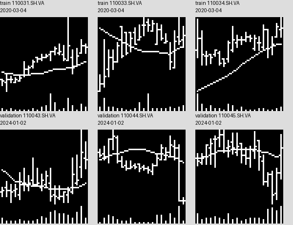
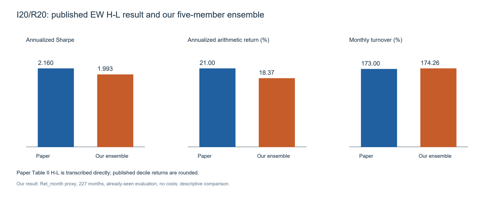

# (Re-)Imag(in)ing Price Trends：I20/R20代码复现

Jiang、Kelly、Xiu（2023，Journal of Finance）原论文的课程复现：**作者成品图像 → 自有CNN → 五成员训练与概率集成 → 分类、十分位及组合评价**。本次覆盖I20/R20一种配置，用20日历史图像预测月度涨跌。论文：[DOI](https://doi.org/10.1111/jofi.13268)；公开图像入口：[作者网站](https://dachxiu.chicagobooth.edu/)。

当前分支：[`paper-replication`](https://github.com/Lin7177/cb-image-alpha/tree/paper-replication)。转债迁移版本保留在[`main`](https://github.com/Lin7177/cb-image-alpha/tree/main)。**提交作业请使用上面的分支链接**，仓库根链接默认打开转债版。

## 图像编码示意图



每张图将20个交易日编码成**宽60 × 高64像素**的黑白图像：白色OHLC线表示每日开、高、低、收，连线表示20日均线，底部竖条表示成交量。

**价格图像 → 三卷积块CNN → 上涨概率 → 五成员概率平均 → 十分位与H-L评价。**

## 已完成的工作与结果

基于作者`monthly_20d`图像独立实现训练、验证早停、checkpoint保存/恢复和五成员评价。开发池778,507行，每成员训练544,954 / 验证233,553；五次训练共44个完整epoch、约6.17小时。历史评价为2001-01至2019-11，共1,387,781行、227个月。

| I20/R20指标 | 原文Table II | 本项目五成员集成 |
|---|---:|---:|
| EW H-L年化Sharpe | 2.16 | 1.9933 |
| EW H-L年化算术收益 | 21.00% | 18.3717% |
| EW月频换手 | 173.00% | 174.2595% |
| 分类准确率 | 未转录 | 53.2823% |

准确率需结合always-up **53.0220%**理解，增量为**0.2603个百分点**；AUC=0.537224。VW H-L Sharpe=0.3159，结果对权重敏感。全部成员、完整11行原文对照及来源见[公开结果说明](reports/paper-i20r20/README.md)。



结果属于**单配置受限描述性复现**：采用`Ret_month`代理收益，真实收益端点未验证；历史评价已见、2019只有11个月；未扣交易成本。五成员波动不是置信区间；未重建原始CRSP到图像链路。其他八组和转债扩展不在本次课程范围。

## 从正确分支开始

```powershell
git clone --branch paper-replication --single-branch https://github.com/Lin7177/cb-image-alpha.git
cd cb-image-alpha
```

**演示一：重算公开结果。** Python3.12标准库即可，无需数据、GPU或安装项目依赖。

```powershell
python scripts/paper_demo.py --mode results
```

该命令验证公开文件摘要，读取已公开的227个月组合表，重算EW/VW年化收益、波动和Sharpe，核对分类分母、基线及五成员波动，并生成可独立打开的HTML。终端打印本次`artifacts/course-demo/<run_id>/`路径；打开其中`report.html`即可查看全部图表。输入是聚合表，不是原始图像重跑。

**演示二：运行同一套CNN与训练保存代码。** 使用Windows、Python3.12及现有`uv.lock`环境；已验证PyTorch2.8.0，默认CPU，无需GPU或外部行情。

```powershell
uv sync --locked
uv run --locked python scripts/paper_demo.py --mode workflow
```

流程为：256训练/128验证合成二值图像 → 原`PaperCNN`与P3引擎运行第1个epoch → 提交checkpoint并停止 → 恢复模型/Adam/RNG继续第2个epoch → 校验恢复概率 → 五概率平均手算例子。它验证代码流程，不产生论文市场结果，也没有现场重训五个成员。CPU速度随机器不同；脚本监督上限180秒。每次运行保存配置、日志、环境、退出码和manifest，写入独立忽略目录。

## 熟悉主体脚本

先读[脚本导读与现场演示](docs/paper-walkthrough.md)，按这个顺序定位：

1. [paper_demo.py](scripts/paper_demo.py)：现在可运行的统一入口，分清公开结果重算与合成流程。
2. [contracts.py](src/paper_replication/contracts.py)：样本资格、开发池70/30划分、仅训练样本归一化。
3. [paper_cnn.py](src/cb_image_alpha/models/paper_cnn.py)：64×60输入、三卷积块、二分类输出。
4. [p3_engine.py](src/paper_replication/p3_engine.py)：Adam、训练/验证、早停、保存与恢复；[p3_checkpoint.py](src/paper_replication/p3_checkpoint.py)负责提交链与摘要。
5. [paper_p4_portfolio.py](scripts/paper_p4_portfolio.py)：概率排序、EW/VW十分位、H-L及年化公式。

历史正式入口`paper_data.py → prepare_paper_b.py → paper_p3.py → paper_p4_reval.py → paper_p4_portfolio.py`保留用于追溯，绑定特定run、数据清单和门禁。干净克隆没有历史数据、权重和完整manifest；重新正式训练需要取得同源输入、重新明确运行协议和产物目录。不要把旧入口当作通用的一键重训命令。

## 仓库内容与检查

| 位置 | 用途 |
|---|---|
| `scripts/paper_demo.py` | 两种现场演示入口 |
| `src/paper_replication/`、`src/cb_image_alpha/models/paper_cnn.py` | 论文训练主体；共享模型保留历史路径 |
| `scripts/paper_*.py`、`configs/paper/` | 历史正式评价、分析与冻结配置 |
| `reports/paper-i20r20/` | 轻量公开聚合数据、10张结果/方法图、图像编码示意、来源与精选验收 |
| `docs/paper-walkthrough.md` | 阅读、演示与口播导读 |
| `tests/` | 合成测试；不读取私人行情 |
| `artifacts/`（忽略） | 本机数据、权重、运行日志和完整历史证据 |

早期转债模块和历史文档保留以维持封存指纹与追溯，当前入口聚焦上述论文文件。数据、权重、环境、分享ZIP、论文PDF及外部参考源码不提交；公开聚合表不等于完整重训数据。第三方材料的使用权由其原始许可决定。

```powershell
uv run --locked python -m pytest -q
python scripts/audit_paper_release.py
```

发布审计检查Git文件边界、公开数据摘要与重算、Markdown链接及冻结模型/config/lock摘要。实现测试不证明模型有预测优势。项目动态进度统一见[主控](docs/plans/2026-09-10-foundation.md)；历史协议见[架构](docs/architecture.md)、[数据说明](docs/data-audit.md)及[迁移地图](docs/migration-map.md)。
