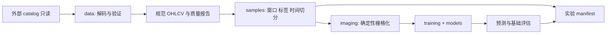

# 系统架构与契约

本文件按阶段保存历史契约，不承载动态进度。G/P后续运行已完成的范围及当前课程任务见[主控顶部](plans/2026-09-10-foundation.md)；2026-10-10新增路线见[课程计划](plans/2026-10-10-course-replication.md)，不修改旧冻结实验契约。

## 形态与边界

采用单进程可运行的 Python 包、显式配置和文件产物。以 PyTorch 为训练框架候选；实现阶段验证 Python/PyTorch/PyArrow/NumPy 的兼容组合后锁定依赖，不复制参考仓库的完整历史环境。



计划目录：

```text
configs/                         # 可共享实验配置；local.* 不入库
src/cb_image_alpha/
  cli.py                         # 薄入口，组织阶段，不包含研究逻辑
  config.py                      # 严格配置校验、路径与版本
  data/{catalog,schema,calendar,aggregate,quality}.py
  samples/{windows,labels,splits}.py
  imaging/{renderer,dataset}.py
  models/paper_cnn.py
  training/{engine,checkpoint}.py
  evaluation/{predict,metrics}.py
  artifacts.py                   # manifest、原子写入、状态
tests/{unit,integration,fixtures}/
artifacts/{datasets,runs}/        # 全部忽略入 Git
docs/
```

禁止模块导入即读全量数据、创建目录或启动训练。只读适配器只返回规范数据，不接收输出路径。渲染器不读取文件或计算标签；模型不依赖 catalog；评估器不重新拟合任何统计量。

## 数据契约

| 产物 | 必要字段/语义 |
|---|---|
| 规范 bars | instrument_id（保留交易所）、session_date、bar_end_ts、available_at、open/high/low/close、volume、source_id、quality_flags |
| 样本索引 | sample_id、instrument_id、window_start/end、decision_time、label_start/end、label_available_at、horizon、forward_return、label、split、image_row、排除原因 |
| 图像 | uint8 `[N, H, W]`，像素为 0/255；I20 为 H64×W60；训练转换为 `[N,1,H,W]` float32 |
| 预测 | sample_id、run_id、split、decision_time、label_end、p_up、真实标签与收益（独立字段） |
| 运行记录 | schema_version、状态、源清单摘要、代码版本/差异、配置与hash、渲染版本、切分hash、种子、环境/设备、统计量与checkpoint关联、指标 |

内部时间保存明确时区的时点；交易日用 Asia/Shanghai 会话历解释。来源时间戳是否收盘标记、是否表示可用时间必须先确认；不能直接假定 `ts_event == available_at`。

日线聚合仅在确认分钟 bar 边界、盘中休市、集合竞价、成交量是否累计、缺 bar 判定后开放。OHLC 使用 first/max/min/last，volume 求和仅对区间增量成立。分钟线不能简单按最近 N 行充当 N 个交易日。

价格收益候选定义：`close(t+h)/close(t)-1`，`label = int(return > 0)`，零收益归 0；`t+h` 按市场交易日历定位，不能跳过停牌日偷偷延长预测期限。缺少终点则排除并记录，绝不当作下跌。这个目标仅是收盘后预测研究标签，不是可在 t 收盘成交的策略声明。

## 图像和样本

I20 每天 3 像素，OHLC 白线黑底，MA20 连线，成交量独立区域。均线覆盖首个显示日需要额外 19 个历史收盘，共至少 39 个交易日上下文。缩放范围和舍入规则按官方行为明确版本，并用合成窗口检查；不采用常规图表库截图、坐标轴、抗锯齿或彩色 K 线。

首版建议完整窗口策略，缺失、不合法 OHLC、历史不足和标签不足均分类计数；这是相对论文允许中间空白列的主动简化，必须在实验中披露。停牌和退出造成的排除偏差不能靠零填充隐藏。不能只保留当前仍上市债券作为历史 universe。

## 时间切分

以市场日期统一划分 train/validation/test，不随机拆分重叠窗口或逐债券各自切分。标签结束及可用时点不得越过所属分区上界；所有训练标签必须在首个验证决策之前可得，验证标签必须在首个测试决策之前可得。边界实现采用严格时点比较，不依赖一个含糊的固定 gap。

验证/测试特征可以使用其决策日前的训练期历史，因为这是真实可得信息。若做更严格的输入窗口隔离，是另一种协议，另行记录。归一化统计量只由最终保留的训练图像计算，验证/测试复用；测试集不参与早停或配置选择。

## 产物与恢复

规范 bars/样本/预测计划使用 Parquet；图像先采用可分片的 uint8 NPY + 索引，避免海量 PNG 文件，少量 PNG 仅用于目检。是否压缩与分片大小由实测样本规模决定。

每个运行目录保存 `manifest.json`、解析后的配置、`metrics.json`、预测表、最佳 checkpoint、归一化参数与日志。数据集单独有 manifest 和排除计数；训练引用其唯一 ID。源文件清单至少记录相对路径、大小、修改时间和schema；正式构建对实际读取内容做摘要或明确指纹强度。全库校验不是本轮工作。

写入采用临时文件再原子替换，临时文件也必须在产物根目录内。运行状态区分 running/completed/failed，不覆盖既有 run；失败留下可诊断记录。不同 seed 不必位级一致，复现实验应声明设备/确定性限制。

## 数据保护和测试重点

解析真实绝对路径并检查大小写、junction/symlink 解析后，任何输出目录都不得与源目录相同或嵌套交叉；不得通过源目录中的链接写入。不得对外部源使用具有写副作用的 catalog 构造器。缓存、临时目录、日志和第三方自动输出统一位于本项目产物根。

重点测试：定点/二进制解码、交易日边界、时间切分与标签端点、未来数据扰动不改变历史特征、图像像素快照、最佳 checkpoint 恢复、预测索引对齐、只读路径拒绝。模型仅做形状、有限 loss/gradient 和保存加载验证；不把训练精度必须上升设为自动验收。

## G1数据政策 v1.1（2026-09-11同版审定PASS）

机器契约：configs/data_policy.toml，由src/cb_image_alpha/config.py严格读取。以下区分已验证事实与研究假设，不能混称。

| 内容 | 冻结定义 | 证据和限制 |
|---|---|---|
| 总体 | 历史身份表与catalog日线目录交集，全928个目录；不按当前价格/溢价率筛选 | 可用catalog总体，不声称完整全市场；缺失身份另计 |
| 编码 | OHLCV全部signed little-endian i128 / 1e16 | 全928文件metadata相同；不按旧分析脚本对volume另除1e9 |
| 日期 | 按原始编码墙钟日期映射上海交易日；保留ts_event/init | 全663328行15:00标记；这不是实际到达日志 |
| 可得时间 | assumed_session_eod，当日23:59:59 Asia/Shanghai | 明示建模假设，不宣称供应商当时已发布，不支持同收盘成交结论 |
| 价格 | catalog价格，不含票息、赎回现金流，不额外复权 | 无CB因子证据、510685条close旁证完全匹配；上游OHLC可能已修复，不称全部原始未加工行情 |
| 数量 | catalog存储数量单位，不反推原始张/手 | 物理单位无法确证；窗口max相对量对统一正倍数不变，但上游量化/填零不可逆、历史单位改变不可排除 |
| 历史窗口 | 显示20日、MA20共需39连续交易日价格，gap排除、不压缩或填造 | 额外19日只要求价格完整；显示20日有零量排除并按年份/split计数 |
| 标签预备口径 | R5按市场日历端点，零收益归0，缺端点计label_missing | 不要求未来中间4日bar存在，不按未来量筛选；未来零量端点仍用close，不代表可交易收益 |

最后两项仅冻结供G2实现的契约，不表示已构建任何样本或训练结果。
G1验收确认的是可解释的catalog格式、数据质量和明确研究使用政策；不能证明历史真实到达或原始物理单位。相较v1.0“所有语义无未决”，这是将不可恢复的来源信息列为使用限制、将研究时点作为显式假设的协议变更，须双独立与交叉审计。若用户需要精确原始成交单位/可交易时点，应补源证据，不可沿用此基线作该声明。

源保护：reader无输出参数且不创建目录；构建入口必须校验输出在项目产物区、与源目录无父子交叉，解析junction/symlink。严格拒绝不符metadata、非单文件目录、目录身份不符、重复编码日期、非15:00编码标记和非法OHLCV。身份表和日历以及全部实际bar指纹进入manifest；全源前后内容hash一致检查仅证明这段运行无观测内容变化，不防恶意外部并发竞争。


## G2时间切分协议 v1.2（用户已批准）

沿用v1.1窗口/标签政策。候选决策为每个身份匹配标的的实际bar日期；缺决策bar不创造样本，另报告覆盖缺口。历史不足、39日gap、显示20日零量、缺未来第5交易日端点、跨界标签依次排除，主原因互斥；另保留阶段前后计数，按年份及候选split对账。额外19日零量不排除，未来量不影响入样。

已批准按决策日期固定：train为2020-01-02至2023-12-31，validation为2024全年，test为2025-01-01至2026-07-31。区间端点为民用日期，实际决策只取市场交易日。依据G1已验证2020至2026-07覆盖，采用完整年度边界并保留最新约19个月测试；未查看模型/收益指标选择边界。训练积累四年，验证覆盖独立一年。不是按各split有效样本比例优化日期。

purge要求label_end不超过所属日期区间末日，且训练label_available_at严格早于市场日历中首个验证决策时点，验证同理对测试；首个验证/测试决策时点指相应分区首个市场日历交易日的23:59:59 Asia/Shanghai（v1.1 assumed_session_eod），不指实际保留的首个样本；比较预定日历边界，不随入样结果漂移。test末端不足R5排除，不延长到库外，不在G2评价测试预测或收益表现。允许验证/测试借用过去的训练期历史特征。

备选：按交易日比例切分容易随数据版本漂移；滚动切分引入多轮模型选择，超出首个单次实验。首版采用上述固定日期建议。这是首次冻结具体实验日期，对G2及G5/G6有影响，G1数据验收不失效；用户已批准，现由configs/splits.toml固定并按此构建G2样本。

后续实现接口：纯窗口/标签/切分函数；sample_id由政策版本、标的、决策日期确定；标签直接比较端点close保证零收益分类精确，收益数值保留计算精度定义。样本Parquet与manifest绑定源/身份/日历/配置/代码指纹及排除计数，独立重建核对索引。未来数据扰动测试分别验证历史特征不变、标签允许随端点变化；真实逐项核对及purge边界测试完成后才判断G2 PASS。
覆盖依据：artifacts/data_audit/quality-20260911T053105796931Z.json；生产读取复验reader-validation-20260911T062403608042Z.json。本协议不依据各年有效样本量/标签分布优化日期；若后续发现空split等结构不可行，保留证据并停下重新审定，不自动移动边界。
### G2实现契约补充

用户已明确批准上述固定日期，configs/splits.toml为生效配置；data_policy.toml仍保留v1.1已审定数据语义。此前“待确认”描述是提案历史，已由本次批准取代。
候选为实际bar日期，早于首bar的39日上下文不足记history_insufficient；上下文内部缺bar记history_gap。按文中顺序仅计一个排除主原因，因此缺端点且跨界记label_missing；不改变最终纳入集合。缺决策bar不生成候选，单独报告首末bar之间市场日历缺口，不推断上市/退出边界。
收益以Decimal局部34位有效数字ROUND_HALF_EVEN计算并保存字符串；标签直接比较原始Decimal close，不依赖四舍五入后的收益。sample_id为g2-v1.2、完整标的ID及决策日期的SHA256；数据集manifest指纹标识具体数据版本。image_row只是未来图像对齐序号，G2不生成图像。
samples.parquet保存索引、起止close、明确时区可得时点；decisions.parquet保存每个实际bar的唯一主原因；summary按年/候选split/原因计数，retained加全部排除等于候选。manifest保存锁/相关源码/配置/源文件/身份/日历内容指纹、环境、产物指纹与状态；重建必须输入完全一致且逻辑样本和计数精确一致。所有写入在独占artifacts/datasets运行目录，失败保留failed状态。
G2于2026-09-12完成独立交叉验收PASS；实现及结果入口见主控当前交接。此为G2历史交接记录；图像/模型现已按G3节验收。

## G3 I20规范 v1（2026-09-12验收PASS）

沿用G1/G2，渲染只接收按市场日历核验的39日上下文，不接收标签。float64 MA20涵盖每个显示日及此前19个close；以首显示close共同缩放OHLC与MA，显示20日OHLC及MA的共同min/max映射到50个纵向间隔。np.rint按实际float64值ties-to-even，不声称十进制半像素绝对精确。
成品uint8[64,60]，0/255：价格行0–50、空行51、量行52–63；第i天中心x=3i+1，high-low一列，open左tick，close右tick，MA中心逐段白线（Pillow固定锁版本，无抗锯齿）。量高rint(12*v/max(v))；保留官方Pillow对零高线段的裁剪行为（最低一像素），不额外筛小正量。
39日不足、身份/时序/值非法、显示零量、全价格与MA极差为0均显式失败；不自动丢样本、不改变G2索引。完整窗口由构建入口按日历验证，不能用连续39行替代。
CNN：Conv2d(5,3)，padding(2,1)，channels 1→64→128→256；仅首层stride(3,1)/dilation(2,1)，后两层均(1,1)。每层Conv→BN(eps1e-5,momentum0.1)→LeakyReLU(.01)→MaxPool(2,1,ceil_mode=True)。卷积输出高20/10/5，池化后10/5/3；宽恒60。Flatten46080→Dropout(.5)→Linear2，无输出softmax；参数708866。
Conv/Linear权重Xavier uniform；Conv bias保留框架默认uniform，Linear bias=.01；BN权重1/偏置0，初始running_mean0/running_var1。独立实现使用解析尺寸，不执行官方构造时的随机dummy前向，因此不继承其BN初始化统计副作用/RNG消耗；不声称与官方相同seed下初始权重位级相同。此差异须验收审计明确接受，不改论文结构或训练数据协议。
G3产物为Train/Validation固定样本的图像验收子集，不声称全量图像缓存完成。映射同时保留G2 sample_id、image_row与子集shard_row，manifest绑定父样本产物hash、渲染版本/代码/环境、像素摘要。Test不参与渲染设计或目检。全量图像物化属于后续经批准的执行工作。
## G4 smoke固定配置（2026-09-12）

沿用G1–G3与父G2索引。每个Train/Validation分区按sample_id升序各取256/128条，不参考标签或指标，不随机划分；训练内部以固定Generator打乱批次。Final Test不用于样本选择、图像渲染、归一化、早停或指标。
configs/smoke.toml冻结seed20260912、Adam lr1e-5、batch128、max_epochs4、patience2（严格小于才改善，平局保留首个最佳）、CUDA内存分配比例0.5、训练300秒预算（每批开始、验证后及恢复推理后检查；超限不可completed）。无隐式CPU回退；准备数据不算训练计时，独立推理进程120秒上限。配置/选择清单/输入hash/环境均在训练前落盘；训练前发生render错误直接failed，不静默剔除样本。
本次训练子集uint8先除255，按全部训练像素计算float64总体mean/std（ddof0）；验证复用，模型输入float32。保持论文CNN和G3初始化，采用确定性算法、禁cuDNN benchmark及固定CUBLAS配置。
best.pt保存最佳epoch模型、同期optimizer、seed、torch/CUDA/shuffle RNG、归一化和输入指纹；结束从磁盘恢复最佳模型及optimizer，不将最后epoch当最佳。smoke目标是最佳checkpoint恢复和预测闭环，并非任意中断点续训服务。
验证：同进程新实例重载推理精确一致；独立进程从best.pt/images.npy重建预测，以预声明atol1e-7/rtol1e-6比对。概率有限/和1、sample_id完整无重、清单及数量对账；独立重算train-only统计量并以历史validation_loss最小值核对最佳epoch。指标为smoke分类accuracy与log_loss（报告概率下限1e-12），不以改善/优于基线验收。
运行产物包含inputs/config/environment/selection-statistics/normalization/metrics、images/labels、best.pt、predictions与独立验证报告；running/failed/completed显式区分，只有独立验证exit0且代码/输入指纹复核后completed。所有输出位于独占artifacts/runs/smoke-*，父G2排除统计用内容hash引用，本次另记录eligible/selected/not_selected/render_excluded。
G4实际恢复证据：smoke-20260912T020142381581Z，epoch3早停并恢复epoch1；同进程及独立进程推理差0，输入384条、归一化仅Train256、Validation128复用，无渲染排除。正式状态/审计以主控为准。该checkpoint用于smoke复核，不是G5正式模型。
## G5正式实验冻结协议 v1（用户已批准）

沿用G1–G4方法契约，正式父数据集固定为g2-20260911T110359965423Z及其内容指纹。使用全部已保留样本：Train339682、Validation123747、Final Test151024（总614453）；不按收益、类别或smoke表现重新筛选。日期/右界purge、I20渲染和paper-i20-v1不变。无法渲染或输入hash变化即失败并停下，不静默丢弃或缩小正式范围。

训练提案：单seed20260912、Adam lr1e-5、batch128、patience2（验证loss严格下降，平局保留首次最佳）、max_epochs20；禁随机train/val拆分，训练分区内部固定seed打乱。保留G4确定性设置，FP32，无AMP、调度器、集成或超参搜索。重新初始化CNN，仅用完整Train图像像素拟合mean/std；不复用smoke权重或统计量。max_epochs是预先规定的终点，不要求准确率改善或早停一定发生。

资源提案：本机CUDA、GPU内存分配比例0.5、num_workers0、分片/内存映射图像，工作进程树合计工作集RAM监督上限8GiB（程序至少每秒采样，发现越限即终止并failed，记录采样峰值；不声称毫秒级无瞬时越限）；新run目录总产物预算8GiB，包含临时分片、预测、checkpoint和该run失败残留，不含既有G1–G4产物。2026-09-12读到D盘空闲约49.6GiB，全部uint8图像理论载荷2359499520字节（约2.20GiB），不在RAM同时物化全部float32图像。Train/Validation图像准备及统计30分钟、训练2小时、封存后Test图像生成与各split最终评估合计30分钟，各阶段由程序监督超时；超资源/超时保留失败记录并停下，不临时调batch或追加epoch预算。实际监督实现需在正式运行前验明；现smoke整体float32物化路径不能直接用于全量，须按批读取和归一化。

Final Test流程：先只准备Train/Validation，训练结束从验证选出best.pt，写入封存记录（checkpoint/config/normalization/train-val输入hash、best epoch、停止原因）。封存记录成功后才生成Test图像、做一次正式预测/指标评估；不目检Test图，不回流模型选择。Test首次读取/评估时点记入不可覆盖事件记录。封存前运行失败保留记录并停止，等待用户确认恢复，不自动换seed/batch或加预算；封存后失败只允许同一已封存模型的机械恢复/校验，不重新选择模型；数据或协议bug须停下、保留已查看历史并审定失效范围。

产物：正式配置/源与数据及代码指纹/环境、分片图像manifest及sample_id-image_row-shard_row映射、归一化、训练历史、最佳及恢复checkpoint、封存记录、各split完整预测/标签/指标、资源耗时/显存、分年split排除统计及方法偏离。全部标formal且新run_id，不更名smoke。失败不写completed；G5成功不代替G6独立重建。

指标冻结：accuracy（p_up>0.5为1，否则0）、二分类log loss（仅计算时概率clip到[1e-12,1-1e-12]）、balanced accuracy（两类recall均值）、ROC AUC（原始p_up、平均秩处理ties）。缺任一类时balanced accuracy/AUC为null并说明原因，仍报告类别数。基线仅使用Train正例占比的常量概率及Train多数类（平局0），Validation/Test不拟合基线；输出CNN与基线同范围指标，不以胜出作为PASS。

用户已批准正式全量范围/20epoch上限/资源预算和封存后Test评估协议。此前G1–G4 PASS不失效；G5.1在机器配置及实现验明后勾选。二值像素总体统计使用精确白像素计数p和sqrt(p*(1-p))，等价于除255后总体mean/std；仅来自全量Train。运行实现及验收状态见主控。
## 后续开发研究协议 research-v2（审计修订草案，待用户确认）

这是G1–G6之外的新开发协议，原实验/配置/产物不修改。主控v2草案定义G7–G9的执行边界；进入某Gate需另行确认。所有新输出标development，不标formal-confirmatory。本节与主控先经双独立、再交叉审计；方案审阅通过不等于实验PASS。

### 证据、解释与未知

已证实：G5最佳epoch5、epoch7早停；最终eval的Train/Validation AUC为0.6120/0.5443，log loss为0.67379/0.69338，Validation常量基线0.69265。G6同机索引/图像精确重建、全部Train/Validation恢复概率差0。这排除了已覆盖的映射与恢复错误，不证明优化充分或研究设计正确。Test已公开整体AUC0.49839/BA0.50077/log loss0.71429，仅沿用历史结论，不进一步切片。

候选解释：泛化差距、时间变化、过强/不足正则化、优化不足或随机性、像素量化/归一化丢失信息、仅OHLCV对R5的预测力弱。训练历史loss是train模式且跨参数更新汇总，最终指标是固定权重eval模式；两者差异不能直接判为训练bug。一次负结果不能推出CV普遍无效；多个简单模型失败也不是信息论上限。

### 数据权限与证据等级

开发允许范围为原Train2020–2023及Validation2024。2024已参与G5早停且看过表现；2020–2023也参与G5训练，后续回放全部是自适应研究后的开发证据，即使严格时间顺序也不是新的未见确认集。Test2025–2026.07禁止本阶段读逐行预测/标签做切片、调阈值、选特征或训练；只引用已发布整体结果。未来如需Test深入诊断，必须另行批准探索性研究，记录所有查看与候选变更，永久降低其确认性；本方案不请求这项权限。当前未证明存在新未见数据；未来新增时间段须先确认数据确实未用于决策、覆盖及质量，再单独冻结一次确认性评估协议，不能因日期新就自动视为未见。本轮不安排确认性Gate。

G7按split过滤后读取预测/图像，避免读全表再探索Test；原始文件可能包含其他日期，适配层只向分析暴露<=2024且满足decision_time的39日上下文，禁止未来字段进入特征。新折叠、特征和训练窗口都登记research-v2；I20/R5语义不变。若发现影响历史样本/标签的缺陷，停止并提出受影响Gate/run失效范围，不覆盖旧结论。

### G7固定诊断面板（无新拟合）

输入用既有Train/Validation预测、标签、图像、history/best元数据与父G2排除统计；为核验量化前后差异，另外只读固定2048个Train样本对应的原39日OHLCV上下文，纳入源/窗口指纹，不扩大日期或样本。输出一个diagnostics.json和图表集合、假设台账（支持/削弱/不可识别）及G8 go/stop理由。预先固定：按年与季度的样本/正例率、row log loss/AUC/BA、常量基线差、概率分布、10个固定等宽概率区间可靠性图；无阈值选择、重校准或自动regime挖掘。对无双类的AUC标null，<20个交易日的分组仅列描述统计，不作方向决策。Train指标为样本内，2024为选择用验证，不称独立OOS。

从Train按sample_id（SHA256身份摘要）升序固定2048个窗口，记录年份/标的覆盖；仅作固定便利样本的机制核验，不估计总体压缩率或总体误差分布。仅核量化误差、OHLC/MA点重合及量柱压缩，报告价格/量归一化不变性；不按预测错对选图、不挖Test。这能证实编码损失的存在，不能证明损失的是预测信息。审阅有限梯度、loss记录及checkpoint状态；不补训练。聚合若显示校准差/时期集中，仅产生候选解释；若发现数据/实现矛盾则BLOCKED。无法判因也是有效交付。每个假设必须注明能排除什么、还混杂什么。

### G8固定时间顺序比较（3折、零超参搜索）

所有方法使用同一父G2候选样本，保持原历史排除，不重新纳入被G2 purge的行；新边界只额外purge，逐方法ID精确对账。全日期而非随机划分：

| 外层开发回放年 | 内层训练 | 内层验证/选epoch | 最终拟合 | 外层评分 |
|---|---|---|---|---|
| 2022 | 2020 | 2021 | 2020–2021 | 2022 |
| 2023 | 2020–2021 | 2022 | 2020–2022 | 2023 |
| 2024 | 2020–2022 | 2023 | 2020–2023 | 2024 |

每个训练/内验证/外评分段要求label_end不超过该段右端最后市场交易日；后段I20/MA20历史可跨左界，绝不跨label右界。内层训练的所有标准化只拟合内Train；最终拟合时在完整前缀重新拟合。外层年只评分一次，不选模型、epoch、阈值；全部三折完成后统一揭示比较结果。已知旧历史不能消除，但新实现不使用外层早停。训练内batch洗牌不等于随机train/val切分。

固定方法：A=每折最终训练正例率常量概率（另报多数类，平局0）；B=数值连续表示U的L2 logistic；C=对应量化表示Q的同一个L2 logistic；D=原paper-i20-v1 CNN。U为显示20日的OHLC+MA20五列按渲染器共同min/max映射到[0,1]，量除窗口max，共120维；MA只使用原39日上下文。Q价格为rint(50*U)/50，量为max(1,rint(12*U))/12，反映实际可见量柱高度。两者不含价格绝对水平、归一化前幅度或成交量单位，避免给基线额外历史/信息；量化后的数值坐标并不包含像素叠加遮挡，是对量化的受控比较，不是逐像素等价模型。

B/C不做内层拟合/选择，每折仅在该折最终训练前缀拟合一次；D内层与最终拟合分别计算各自Train统计。B/C都按最终Train每列mean/std（float64、ddof0）标准化，零方差列置0并记录；目标mean BCE + 0.001*||w||²/2，截距不惩罚、无class weight、CPU float64全批确定性LBFGS，lr1、history_size100、strong_wolfe线搜索、最多200个优化迭代且closure函数/梯度评估硬上限400次，第401次不得执行（不能只依赖框架max_eval参数），tolerance_grad1e-6、tolerance_change1e-12，初值0。结束核验最终参数的有效梯度无穷范数<=1e-6才算收敛；可复用同一最终参数的已计算梯度，若需额外forward/backward也计入400次总预算，不得隐含第401次；参数变化很小或到达步数本身不代表收敛。不达收敛则BLOCKED而非临时放宽/换算法。上述数值先验冻结，尚未真实数据试配，若合成验证暴露实现问题应在看真实拟合前修订并记录。实现前合成正确性与有限梯度核验不计真实拟合预算。B/C每折各1次，共6次，不选lambda。

D每折先在内层按G5固定Adam1e-5/batch128/max20/patience2选首次最小验证loss的epoch，再从头在最终前缀按该epoch数拟合一次，外层评分。单seed20260912，FP32，CNN结构/renderer不变；每折2次共6次CNN训练，不重用G5权重，不能复用在外层年训练过的旧checkpoint。所有方法共享样本、标签、过去信息和外层评分次数；CNN有预注册内层选epoch而logistic固定优化解，这是不同训练机制，不声称计算预算相同；均零研究者超参搜索。新依赖须锁定新研究环境，不改G5 uv.lock，优先现有NumPy/Torch实现。

主比较为每折相对A的row log loss差及B-C配对差，AUC/BA辅助；报告样本数/类比例、逐折值及三折等权平均，不只挑最佳折。附日期等权loss敏感性，防大截面日期支配；所有样本按日期整组，配对20交易日移动块bootstrap500次、seed20260914，不按行IID抽样。每折在该折完整交易日序列上独立抽起点均匀的非循环连续20日块（起点0至T-20），拼接到至少T日后截断为T日；同一日期块保留所有截面行和所有方法，重复日期按出现次数计权，row loss差按重采样行数重算。实现可预聚合每日各方法loss总和与行数，按抽中日期重数sum/count，精确等价于重采样整组行；不得去重。区间仅针对主log loss差，AUC/BA只报告点估计，不做500次重排序。各折独立抽样后每次取三折loss差等权平均，跨年不拼块；日期等权敏感性按重采样日期均值计算。少于20个有效日期时不计算块区间并说明，不能换块长补救。单类仍可计算log loss及其区间，只将AUC/BA标null并说明。区间只描述开发数据的不确定性，不作确认性p值或因果检验；相关依赖可能超过20日，三个时期也不足以精确推断。完整报告所有预注册比较，不基于区间反复试block长度或挑子群。

正负分支：B优于C且3折loss差方向一致只支持“此线性模型对量化敏感”，不能直接解释CNN失败；B/C有效而D弱只提示模型/表示机制差异，不能单因归因；均弱只削弱当前有限OHLCV表示族的假设，优先停止CNN优化；跨年反转提示时间不稳定，不直接证明机制变化。每种说法都保留容量/优化混杂。方向一致但很小或不确定的差异可记录而不继续；G9没有自动触发权。

### G9条件性判别，一次只选一个分支

仅G8完成且还有会改变研究决定的具体未知、用户批准分支后执行；申请必须分别写出正/负/不确定三种结果如何改变继续或停止决定，若三种结果都要继续则不批准该判别；否则关闭研究路线而不为补齐编号训练。须先冻结单一假设、输入、比较和次数，最多一个分支，不并行搜索：

1. 若D与数值基线分歧且优化/seed仍是关键未知：只增加seed20260915，重做相同3折D（内层+最终，共6次）；与G8原seed全量并列，不挑seed。两seed只测试敏感性，不估计充分随机稳定性；不改lr/dropout/patience。
2. 若U/Q均弱且归一化不变性可能移除了幅度信息：仅给U增加两个过去可得标量——窗口价差/首显示close、close20日收益波动率（19个相邻log return总体std）；同一logistic规则3折各1次，比较U。明确这是feature-v2.1新增信息，不是同信息模型胜负；无新标签/交易假设。数据不足不能放宽原样本集。

两个分支均不得根据Test选择。分支2正结果支持继续研究尺度信息，负结果停止该轴；分支1高度敏感削弱单run解释、不触发挑seed，若仍弱则停止该CNN配置优化。一次分支后强制总结并停止，不追加第二轴；另一路须新证据与新授权。没有新未见数据时只有开发结论，不升级确认性成果。

### G7固定诊断结果（2026-09-14，development）

证据目录artifacts/research/G7/g7-20260914T074736840980Z，diagnostics.json为固定面板，hypothesis-ledger.json按H1–H7分别记录事实、解释、限制、下一判别。只读Train339682/Validation123747既有预测；量化机制样本为固定hash前2048个Train窗口（599标的，2020/2021/2022/2023分别316/497/558/677），不外推总体。

| 解释 | 当前证据及强度 | 不能推出的结论 |
|---|---|---|
| 映射/恢复或明显数值故障 | 被已覆盖检查削弱：G6历史恢复一致；G7父ID、选定图窗坐标、有限checkpoint与best epoch一致 | 未测故障不存在、优化已充分 |
| 过拟合/泛化差距 | 差距可见：Train相对常量loss差-0.01904，选择用Validation+0.000733；AUC0.6120→0.5443 | 差距只能由过拟合造成；需要调dropout |
| 时间变化 | 描述性时期异质支持：2024四季度相对loss差-0.004488/+0.010558/-0.025411/+0.025823；Q3/Q4 AUC0.6318/0.4576 | 结构变点、显著regime或择时规则已识别 |
| 校准/类别比例 | 全年Validation均值p0.48235与正例率0.48385接近，削弱全年均值严重错配；[0.6,0.7)桶9559例均值p0.63267而正例率0.54294，支持桶内偏差 | 聚合均值近似就是校准；立即拟合校准器 |
| 编码损失 | 固定样本共同OHLC+MA范围归一化的平均坐标绝对误差0.004893；量柱单像素11105/40960，原round到0为3375/40960；新增同y对16774/409600，high-low坍缩23/40960 | 同y必为同像素、总体压缩率、损失的是预测信息 |
| 优化不足/随机性 | 不可识别：历史train模式loss下降，best5/stop7，单seed且无新训练 | 有限梯度/下降loss证明找到足够好最优解；train模式与eval loss可直接比较 |
| 原始OHLCV预测力不足 | 不可识别：目前拟合模型只有CNN，常量不是同信息的拟合基线 | CV无效或信息论上限已确定 |

quarter-loss.png中的2020–2023为样本内，2024为已用于选择的Validation，不能把相连曲线解释成滚动OOS。reliability.png按固定10桶绘制，Validation[0.1,0.2)只有4例，不解释稀疏左端；桶的完整人数见JSON。没有置信区间/显著性检验，不根据表现选子期。价格误差分母是显示OHLC+MA共同范围，不是价格涨跌百分比；量误差分母是该窗最大量。归一化对price×2/volume×3保持不变只说明尺度被消去，不说明尺度有预测价值。

建议进入原定G8：时间顺序三折能检查描述性差异是否在同规则前缀拟合后重现；U/Q同族logistic能隔离该线性模型的量化敏感性，与CNN并列能补上简单拟合基线。保留原6次logistic+6次CNN预算，不加入季度挑选、校准或参数搜索。若全部弱则优先停止当前轴；正结果也只是开发证据。G7不能确定唯一原因，因此G8有信息价值；需用户确认，当前不执行。

### G8固定三折结果（2026-09-16，development；双Agent正式交叉审计PASS）

批次 `artifacts/research/G8/g8-20260915T032338487327Z` 全部执行completed。仅原Train/Validation；三折全部完成后统一评价，未读取Test进行分析/训练/推理。2024曾被使用，且其最终训练前缀、seed和5epoch与G5相同，不能把2024视为新的独立确认。历史G0–G7结论不覆盖。

| 外层年份 | 方法 | 样本数 | Log loss（主指标，低好） | AUC | Balanced accuracy | Accuracy |
|---|---|---:|---:|---:|---:|---:|
| 2022 | Constant | 92,246 | 0.696003 | 0.500000 | 0.500000 | 0.463023 |
| 2022 | U | 92,246 | 0.694161 | 0.554249 | 0.535032 | 0.522429 |
| 2022 | Q | 92,246 | 0.694073 | 0.554367 | 0.535147 | 0.522527 |
| 2022 | CNN | 92,246 | 0.705056 | 0.550561 | 0.532958 | 0.548295 |
| 2023 | Constant | 113,858 | 0.692577 | 0.500000 | 0.500000 | 0.534403 |
| 2023 | U | 113,858 | 0.694433 | 0.529542 | 0.517413 | 0.520569 |
| 2023 | Q | 113,858 | 0.694375 | 0.529810 | 0.517611 | 0.520815 |
| 2023 | CNN | 113,858 | 0.706341 | 0.526803 | 0.517534 | 0.527034 |
| 2024 | Constant | 123,747 | 0.692652 | 0.500000 | 0.500000 | 0.516150 |
| 2024 | U | 123,747 | 0.688868 | 0.551196 | 0.533710 | 0.536352 |
| 2024 | Q | 123,747 | 0.689010 | 0.550708 | 0.533809 | 0.536449 |
| 2024 | CNN | 123,747 | 0.693385 | 0.544320 | 0.529855 | 0.532781 |

三折等权平均log loss：Constant 0.693744、U 0.692488、Q 0.692486、CNN 0.701594；对应AUC：0.500000、0.544996、0.544962、0.540561。排序指标与概率损失分开解释，不以accuracy/AUC局部上升替代预注册主指标。

- U−Constant：2022/2023/2024为−0.001841/+0.001856/−0.003784，两折改善、一折恶化；均值−0.001256，描述性95%日期块区间[−0.009424,+0.003703]。有 有限排序关联（U三折AUC均>0.5），尚无稳定概率预测优势。
- U−Q：+0.000088/+0.000058/−0.000141，方向混合；均值+0.00000155，区间[−0.000109,+0.000100]。量化没有呈现跨折稳定退化；不等同于证明无信息损失，也不是等价性检验。此比较包含标准化后的有效L2尺度变化，不是纯像素实验。
- CNN−Q：+0.010982/+0.011966/+0.004375，三折点估计均恶化；均值+0.009108，区间[−0.002640,+0.021246]。未看到CNN增益，但全部单折及均值区间跨0，不能称已统计确证CNN劣于Q。日期等权下上述跨折方向一致，U−Q三折均值仅在接近零处变号。
- 区间为固定500次、20交易日配对非循环块的描述性区间，不是确认性检验；训练前缀重叠、原开发资料已使用、仅单seed，限制结论强度。没有进行新增切片、校准、阈值或超参搜索。

| 假设 | 已证实事实 | 更新与仍不可识别部分 |
|---|---|---|
| H1 映射/数值故障 | 6个Logistic均在78–90次closure内达到梯度上限1e−6；CNN有限梯度检查及流程完成 | 已覆盖的明显故障进一步削弱；不是所有bug或模型充分优化的证明 |
| H2 过拟合/泛化差距 | CNN三折外层log loss均差于Q/Constant | 与泛化或概率估计问题相容，但容量、优化、编码混杂，不能确认为单一过拟合原因 |
| H3 时间变化 | U/Q对Constant的主指标差在2023反转，2022/2024改善 | 开发年份间不稳定得到重复观察；不能建立结构性regime或择时规则 |
| H4 校准/类率问题 | CNN三折AUC>0.5同时log loss差于Constant | 排序与概率质量分离，概率估计问题仍合理；未新增校准面板，不能断言校准是唯一原因 |
| H5 编码信息损失 | U/Q差异小且方向不一致 | “该量化在固定Logistic下导致稳定恶化”的解释削弱；像素遮挡、归一化去尺度及非线性信息损失仍未识别 |
| H6 优化/seed敏感 | 固定CNN各折最佳epoch为4/6/5，单seed、原训练配置 | 有限梯度/早停不证明优化充分；seed与优化不足仍未识别，不为此自动追加训练 |
| H7 当前信息预测力弱 | U/Q排序关联有限，log loss只两折改善且区间跨0 | 削弱当前有限标准化OHLCV方法族的稳定概率优势假设；不能推导原始全部信息无效或CV路线无效 |

建议不进入G9训练，停止当前CNN优化轴，保留开发性结果。理由：数值方法尚无稳定主指标优势，量化差不是突出瓶颈；第二seed即使改善也仅增加单次敏感性证据，不能解决未见数据缺失/不稳定概率优势；负或不确定则同样支持停止，当前信息收益不足以支付额外6次CNN。尺度特征分支尚无直接证据指向尺度是关键损失，不应为补齐Gate尝试。任何后续新研究需提出能改变决策的单一问题、独立协议及用户批准。此处是G8建议，不执行G9、不把G9标PASS。


## Paper B协议（paper-b-v1，FROZEN，2026-09-17）

用户明确批准接受官方Date代理，从原端点阻断进入受限paper-faithful路线。此处覆盖A调查等待裁决状态，不覆盖旧G0–G8及历次事实。Ret_month实际endpoint不可验证，跨OOS风险未排除；不得宣称严格leakage-free OOS。公开OOS文件继续封存，曝光过的网页示例不用于任何设计选择。

唯一初始配置I20/R20使用作者公开月末图像+Ret_month；输入包摘要、开发年份与参数见configs/paper/paper_b_v1.toml。1993–2000按年升序、各年保持文件原行序；sample_id由year+原行号定义，StockID/Date作唯一性核对。所有标的，不做市值/收益幅度/tstat筛选；先排除非有限/占位收益，再排除非有限/非正EWMA，再应用2000-12-01严格小于代理，描述已审计预期778507行，实际P2须重新对账后冻结索引。二分类ret>0为1、零及有限负值为0。

明确保留的实现偏离：不复刻官方np.where把NaN变0的缺陷；有限值修正沿用P1已审定方向，意味着不是逐行bug-for-bug复刻，排除数必须保存。全图像不另加空白/形态筛选；发现异常则阻断。标准化遵循论文：逐成员仅自身70%训练图的全部像素总体mean/std；不采用官方各年头50000图的含OOS归一化。修正这两项不等于声称剩余协议无泄漏。

每成员独立CPU torch.randperm，floor(0.7N)训练、余数验证；5组split/model/shuffle独立固定seed见配置，系本项目可复现选择，非论文原seed。样本ID列表/每成员分区/归一化均保存摘要。70/30池内随机和重叠窗口依赖被保留，不能称内部时间独立验证。单成员只看自身validation loss，严格下降才刷新best，patience2；最佳checkpoint恢复，五成员全部等权softmax概率平均，不平均logits，禁止挑seed。50epoch是代码上限，触顶未早停标capped，不称已达到早停条件。

CNN复用本仓库已独立实现且冻结的PaperCNN（708866参数）；不修改旧文件，不导入参考代码。训练采用float32无AMP、Adam lr1e-5/default betas/eps/zero weight decay、batch128、shuffle仅训练、drop_last=false，模型RNG和loader RNG分开。本机现代PyTorch及未复刻官方dummy-forward随机数消耗为已知偏离。只支持可得I20/R20入口，九组完整范围仍有数据缺口。

P2入口/产物：独立paper_replication包，协议校验、只允许开发年份的读取器、源行映射与过滤账本、五成员索引、逐成员训练像素统计、自有CNN绑定和可恢复训练状态的合成测试。P2程序预算CPU墙钟累计30分钟、新产物1GiB（复用已解压数据，不重复生成图像）；内存<=4GiB；不做真实样本前反向、真实训练或OOS推理。合成测试固定小fixture，无模型选择。PASS要求输入摘要、793019→778507对账、每个成员内部train/validation互斥且并集为同一eligible池（成员间允许交叉）的70/30分区、训练统计无验证/OOS参与、保存加载/RNG/早停/概率平均合成验证、双独立交叉验收。

P3运行前另冻结GPU/CPU时间、RAM/VRAM/磁盘、五fit总预算及恢复政策。只允许训练的五成员，不附加真实smoke或搜索；不够预算则阻断，不缩样本/epoch/成员凑完成。P4在任何OOS解封前另冻结评价表/指标/分位/权重/缺失规则；P2完成不自动授权P4。协议实质变化仍双审，不根据中途结果修改。


B冻结补充：manifest SHA绑定16年度文件摘要，执行核验每项；自有模型源与uv.lock SHA纳入配置。每成员randperm前544954为Train、后233553为Validation，保存原顺序索引。二值图以int64精确白像素计数、float64总体mean/std(ddof=0)，应用为float32 uint8/255→减均值→除std；零std或非二值立即失败。P2唯一attempt，父程序监督墙钟1800秒、进程树RSS4GiB（采样式监测，非OS硬配额）、新增产物1GiB；失败不自动重试或清零。P2若PASS依Gate停止规则交接，不把其PASS当成P3预算冻结。


### P2实际验收结果（paper-b-v1）

唯一准备批次artifacts/paper-v1/p2-paper-b-v1完成：793019原行，排除6542无效收益、有效收益后0无效EWMA、7970有效尾部，778507保留；sample_id=year*1000000000+原行号（原row均<1e9）。每成员544954/233553，五固定seed排列、IDs与训练像素统计经两审独立重算一致。归一化mean约0.10626–0.10631、std约0.30817–0.30823，仅各自Train参与。原字段映射及全部保留图白像素以独立sum/255方法重核通过。

6项新增合成fixtures通过，完整回归128 passed/2 skipped。保存加载精确相等仅覆盖CPU PaperCNN推理和CPU小MLP Adam/dropout/shuffle状态恢复；没有真实训练或CUDA恢复验收。P3前需实现并验证真实训练器、GPU状态及资源策略，不能把P2数据准备当作已跑通正式训练。

准备监督20.531秒、观测worker子树RSS峰913436672B、新产物约116.8MB；0.5秒采样不含监督父进程，非瞬时硬上限。全套测试11.657秒、独立源映射核验14秒，另首轮合成12.19秒；这些额外检查的RSS未统一监督，不宣称所有P2操作都有同等资源观测。辅助对账首次object dtype异常已留痕，修正读取类型后完成，未重跑唯一准备批次。P2验收通过后停止，不自动进入P3或解封OOS。


## P3 Training Protocol（paper-p3-training-v1，FROZEN，2026-09-18）

本轮只制定/冻结协议；真实训练器尚未实现验收，CUDA恢复preflight=NOT_RUN，training_authorized=false。协议通过不等于实现通过，也不授权开训。用户确认后仍须先完成真实训练器的合成CPU/CUDA验收及实现双审，任何真实fit之前保存不可变启动receipt。协议机器入口configs/paper/p3_training_v1.toml；继承paper-b-v1及P2 index/members/归一化，父配置与P2验收/manifest/members哈希绑定，旧文件不改。

### 范围与预算

唯一I20/R20批次按member0→4顺序运行，共5个logical fit，固定P2 sample_id、模型/split/shuffle种子、训练544954/验证233553及各自归一化，不重建、不补样本、不做额外真实smoke。所有标的/Date proxy/NaN修正/70-30依赖按B继承。endpoint未验证且跨OOS风险未排除，禁止严格leakage-free声明；不访问2001–2019图像、标签、预测或示例网页。

| 资源 | 固定上限及解释 |
|---|---|
| 单成员执行墙钟 | 7200秒，含数据读取、训练、验证、checkpoint I/O及该成员获批恢复片段 |
| 五成员合计 | 36000秒（10小时）；顺序执行，不是额外CPU+GPU时间额度 |
| 前置实现合成验收 / 封存 | 各1800秒；执行全阶段合计39600秒（11小时），失败/恢复不清零 |
| 主机内存 | 监督父进程+全部后代RSS求和<=8GiB，每1秒采样；共享页可重复计量，非OS硬配额 |
| GPU | 单GPU；torch allocator reserved<=6GiB，同时设置按实际设备总量计算的allocator fraction；不是整个GPU进程/驱动显存硬限制，其他应用占用导致OOM时停止 |
| 产物 / 空闲盘 | 新P3目录<=8GiB，启动需>=10GiB空闲；含临时/失败/所有epoch快照，原P2输入不重复复制图像 |
| CPU/loader | torch CPU线程4，num_workers=0，pin_memory=false，不并行成员 |

这些是研究预算选择，不是基准测速或完成时长保证。本机已只读核实5060 Laptop 8151MiB、driver581.83、RAM33447333888B、D盘可用约41.8GB，启动时再核验。每秒程序监督资源、每5秒写持久化账本；Agent只在结束/失败/异常介入，不高频读取日志。墙钟达到上限立即终止并保留证据，写文件前估算余量，完成后复核；不因预算不足缩减样本、成员或擅改epoch。额外CPU人工审阅不伪装实测GPU用时。

### 训练与早停语义

模型/Adam lr1e-5、betas/eps/weight_decay、batch128、50epoch/patience2、float32无AMP等完全继承B。补充执行确定性：cudnn benchmark=false、deterministic=true、torch deterministic_algorithms=true、TF32关闭、CUBLAS_WORKSPACE_CONFIG=:4096:8（初始化CUDA前），Adam foreach/fused=false；不支持则BLOCKED，不关闭确定性过验收。无scheduler/梯度裁剪/校准，首次模型初始化前设置该成员固定model seed；训练loader独立shuffle seed，验证loader使用shuffle_seed+1000000的独立generator，不消耗模型随机流。validation不shuffle、drop_last=false；每epoch必须对账train/val各完整无缺重一次。

每epoch训练后model.eval/no_grad跑自己的全部Validation；以float32逐样本CE转float64求和再除精确样本数作为唯一早停指标，不能把最后不满batch等权平均。best初值+inf；严格下降才更新，平手保留较早best并stale+1；连续2次不下降停止。epoch1–50编号，若第50次同时满足patience则early_stopped，否则capped。capped是预先允许的上限终态，必须公开标注，不宣称已达到早停条件，不据此延长训练。全5个成员均early_stopped或capped、最佳权重和产物全部验真方可completed；任何资源/数值/输入错误为failed/BLOCKED。准确率改善或超过基线不是PASS条件。

### checkpoint、恢复与合成验收

每成员初始化后保存epoch0状态；每个训练+完整验证epoch生成不可变目录，保存模型含BN、Adam状态/step、CPU及所有CUDA RNG、Python/NumPy RNG、train/val loader RNG、epoch/global_step、best_loss/best_epoch/stale、完整history、代码/环境/输入摘要、资源账本、该epoch验证sample_id/label/概率及loss。先写临时目录并flush/验证摘要，最后原子提交commit marker，best指针只引用已提交epoch。禁止部分epoch冒充完成、保存张量共享可变引用、只存best而丢last恢复状态；失败临时文件保留、计预算。

恢复必须同一run/member/代码/环境/设备，从最新已提交的完整commit（含epoch0）在新进程恢复；该最新commit必须通过hash校验，损坏则BLOCKED，不跳过它静默退回更早commit；重建对象后恢复全部RNG，重新进入下一epoch。中断epoch不支持中途batch续行，保留partial并仅在获准后按原RNG从上次commit重放，计算耗时照计；不挑表现更好的旧checkpoint续训。首次正式运行前，同一生产训练器在固定合成数据上测试连续vs中断恢复：CPU和CUDA分别与同设备连续执行比较模型/BN/Adam/step/RNG/loader顺序及数值history逐项精确一致，同batch推理精确相等，不要求CPU与CUDA互相相等，也不放宽数值容差。耗时、RSS、PID、路径、时间戳等操作历史保留真实差异，只验结构、单调及预算。测试断点前后、epoch写入中断/残缺commit、损坏hash、非有限值、资源触顶、缺重ID、输入摘要变动和OOS路径拒绝。P2 CPU测试不替代该验收；全部为人工fixture，无真实smoke/调参，失败修实现后保留测试失败账，不清零preflight预算。

### 失败/中断/重试

零自动重试、零自动恢复；任一成员失败即停后续成员，不重跑已完成成员，不换seed或另起run清零。整个批次最多一次额外的用户明确批准续行，不自动获得该批准；需先诊断、验证commit及剩余单成员/总预算。worker终止但监督尚存时记录真实执行耗时；监督也中断且耗时无法可靠界定时，保守占满该成员尚余预算并BLOCKED，不能计零或从checkpoint时间猜测。若需要增预算或修改协议/代码，先独立审计并交用户裁决，当前冻结协议不默认允许。

启动前失败不消耗新的logical fit，但消耗前置验收预算；真实fit在读取首个真实batch之前登记为started，任何失败仍保留计数。历史表现不能作为恢复、放弃某成员或改变参数的依据。用户主动暂停也遵守同样完整commit/资源规则，不把额度恢复当作进程已终止的证据。

### 产物、封存与门禁

启动receipt绑定冻结P1/P2配置、原输入manifest/16开发文件、P2 pool/5成员索引/统计、训练器代码快照/干净提交、uv.lock、Python/torch/CUDA/cuDNN/driver/GPU、确定性环境、所有种子与预算。新模块实现，不修改已绑定P1/P2代码。run目录记录全部退出码/日志/资源/失败恢复、epoch快照与验证预测、样本排除和计数；先验fingerprints失败就停，不从OOS或其他数据补足。

封存五个各自最佳模型与其训练归一化、选择epoch/验证loss、状态early_stopped/capped及文件摘要。每成员固定保存Validation顺序的前128条作为恢复推理对账，使用相同batch形状在新进程恢复，与该best验证输出逐tensor精确核对；验证预测全量sample_id无缺重、有限概率且行数233553。不得把五成员不同验证集直接拼成一份同样本集成得分；仅合成同样本logits验证五softmax均值，实际共同OOS集成留P4。无测试集读取。

状态层次：本轮protocol FROZEN/训练授权false；实现+CPU/CUDA preflight通过为READY_TO_TRAIN（仍需用户开训授权）；真实执行running→failed/interrupted或completed。P3正式PASS需五成员封存、全部对账、原输入未变与双独立交叉验收，不由指标好坏决定；P3结束停止，P4评价协议及OOS解封另审另批。本轮不把未实现检查写成PASS。


P3双审精化（2026-09-18）：commit marker须绑定文件SHA/长度、parent commit hash、epoch、run/member、输入/代码摘要，完整链连续验证；marker最后原子写入，作为提交权威。best指针仅为可重建缓存，若提交后指针更新失败，用已提交history确定性重建，不重算选优/回滚。Windows原子rename不等于断电持久性；文件flush/fsync、故障注入须在生产preflight验证并记录能力，重启后所有hash验证，不能声称已证明物理断电不丢数据。写入前预留完整epoch及最终封存空间；实际序列化体积在合成阶段核验，不足8GiB则BLOCKED，不减少快照凑预算。

恢复预算以持续追加的外部监督账本为权威，checkpoint内账本只是当时快照，禁止恢复时覆盖/回退已耗时资源。probe一律eval/no_grad并保存/恢复全部RNG；CPU/CUDA同设备连续与恢复均须证明probe不影响后续轨迹。固定生产preflight输入为人工二值I20 Train256/Validation128，按冻结batch128和真实PaperCNN/Adam执行3个epoch，对照在epoch1完整提交后中断恢复；不可用另一个toy trainer代替。中途/损坏/预算等故障注入共用预检预算，失败记录不清零；本轮不执行该fixture。

冻结配置中的training_authorized=false与preflight_status=NOT_RUN描述冻结时状态，未来授权/实际preflight结果写独立hash绑定receipt，不修改冻结配置来开启训练。资源/实现审定、用户明确开训确认都齐备才可真实执行；目前只有协议制定获批。
