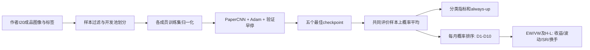

# 从主体脚本到现场演示

你的模块要讲清三件事：我们实现了什么；怎样从图像得到五成员预测；怎样评价与解释原文对照。先熟悉下面六处，历史监督/审计细节只在被问到时展开。

## 先建立一条流程线



I20是20日历史图像，不是20×20像素；实际输入`[N,1,64,60]`，R20在本包对应月频预测/持有口径。工作从作者成品图像开始，未重新渲染CRSP原始数据。旧CB模块有自己的渲染代码，不能拿它当本次美股图像已重建的证据。

## 六处主体代码怎样读

| 顺序 | 文件 / 关键函数 | 你需要能讲出的内容 |
|---|---|---|
| 1 | [paper_demo.py](../scripts/paper_demo.py)：`main`、`recalculate`、`workflow_worker` | 当前演示入口；结果重算与合成运行分开；产物在哪里 |
| 2 | [contracts.py](../src/paper_replication/contracts.py)：`eligibility`、`partition`、`pixel_statistics`、`normalize` | 去掉无效收益/波动、Date代理尾部；开发池内70/30；归一化只看该成员训练集 |
| 3 | [paper_cnn.py](../src/cb_image_alpha/models/paper_cnn.py)：`PaperCNN`、`forward` | 三个卷积块，每块Conv/BatchNorm/LeakyReLU/Pool；Dropout0.5；展平46,080维接2个logit |
| 4 | [p3_engine.py](../src/paper_replication/p3_engine.py)：`run`、`snapshot`、`rng_state`、`restore_rng` | Adam lr1e-5、batch128；训练反传，验证不更新；验证loss严格下降更新最佳，连续2次未改善停止；最多50epoch |
| 5 | [p3_checkpoint.py](../src/paper_replication/p3_checkpoint.py)：`commit`、`committed`、`load_latest` | 权重之外保存Adam/RNG/洗牌/早停/归一化和身份；COMMIT文件+hash父链避免半写入状态被当成功 |
| 6 | [paper_p4_portfolio.py](../scripts/paper_p4_portfolio.py)：`load_predictions`、`portfolio`、`summary` | 共用sample_id/label；上涨概率排序；D10-D1；EW均值、VW按市值绝对值归一化；按月年化 |

补充两处：[p3_data.py](../src/paper_replication/p3_data.py)的`Images.__getitem__`把uint8图像归一化、加单通道并返回label/ID；[state.py](../src/paper_replication/state.py)的`ensemble_probabilities`演示“先softmax后平均概率”。正式评价的概率平均在[重评worker](../scripts/paper_p4_reval_worker.py)中，组合历史分析使用float64概率副本；不要混淆分类主阈值/精度与历史分析列。

建议先用10分钟依次打开`PaperCNN.forward → contracts.normalize → p3_engine.run`，然后从演示入口反向跟进。不要先读完整主控历史或所有Gate脚本。生产引擎中的保存、恢复和ID覆盖检查可以先折叠，理解主训练循环后再展开。

## 两种演示，各自能证明什么

从项目根目录执行。Windows已有`.venv`时用`.\.venv\Scripts\python.exe`；干净克隆先按README建立锁环境，现场不要临时下载依赖。

**结果演示：**

```powershell
python scripts/paper_demo.py --mode results
```

只需要Python3.12标准库。终端打印accuracy与基线增量、EW/VW年化收益及SR；同时校验公开文件SHA、每个月D10-D1、227个月统计、混淆矩阵分母和五成员离散。打开终端最后给出的`artifacts/course-demo/<run_id>/report.html`即可浏览结果。HTML内嵌图，单文件可打开。这证明公开聚合结果可复核，不证明从原始图像重新训练了一遍。文件hash证明快照一致性，不是对研究有效性的证明。

**合成流程演示：**

```powershell
uv run --locked python scripts/paper_demo.py --mode workflow
```

它调用已有生产`PaperCNN`、`p3_data.synthetic`、`p3_engine.run`和checkpoint代码：

1. 固定种子生成256训练＋128验证二值图像与随机标签，使用训练样本像素统计。
2. CPU执行一个epoch的训练/验证，写完整checkpoint后主动结束该调用。
3. 再调用引擎恢复模型、Adam、RNG、洗牌和早停状态，完成第2个epoch。
4. 从最后checkpoint重建CNN，验证128行概率与已保存输出逐元素一致。
5. 单独用可手算logit例子说明五个softmax概率平均：四份0.5、一份0.75，上涨概率均值0.55。

这次中断是可控演示，不是崩溃；没有声称本演示证明与无中断训练的整个轨迹相同。历史恢复检验另有封存证据。最后一步只是集成公式例子，不是现场训练五个模型。随机图像的loss/accuracy不解释为股票预测效果。

默认CPU、监督墙钟上限180秒、进程树RSS上限2GiB、产物上限128MiB；不同电脑耗时不同。`supervision/`含日志/资源账本；`model/epoch-*/`含checkpoint；`workflow.json`含恢复校验；根`execution.json`含退出码。失败保留现场与错误信息，不覆盖旧run，也不自动重试。所有写入局限于本仓库`artifacts/course-demo/`，不读源行情或正式OOS。

## 现场怎么讲、怎么点

如果只是3分钟正式汇报，建议PPT主讲，脚本只作老师追问时的备用。演示约60-90秒即可：

| 动作 | 可直接说的话 |
|---|---|
| 打开分支README | “这份分支是论文代码复现，转债版在main。我们完成一种配置的五次拟合和完整集成。” |
| 打开`PaperCNN.forward` | “输入是64×60的单通道图像，三卷积块输出两个logit，再转上涨概率。” |
| 运行`--mode results` | “这里从公开的227个月表重算收益、风险和Sharpe，同时对账分类基线；不是重新加载股票图片。” |
| 如需证明流程，运行`--mode workflow` | “现场用合成图像调用同一个正式训练引擎，展示保存与恢复，避免把几秒钟演示冒充完整训练。” |
| 打开`workflow.json`或离线报告 | “正式市场结果来自此前五成员训练；当前演示只验证流程。收益为proxy、评价已见且未扣成本。” |

演示前只需确认Python/环境可用，先完整跑一次并记住输出位置。现场出现环境问题时展示已有日志与源码，照实说明，不把旧日志称为刚刚跑出的结果。正式汇报核心数值：SR2.16→1.9933，收益21%→18.37%，准确率53.2823%对always-up53.0220%，EW/VW SR1.9933/0.3159。

## 历史正式脚本怎样对应真实实验

| 阶段 | 历史入口 | 主要输入 → 输出 |
|---|---|---|
| 获取/核查 | [paper_data.py](../scripts/paper_data.py)、[recover_paper_data.py](../scripts/recover_paper_data.py) | 作者ZIP/目录清单 → 开发图像/标签核查与来源manifest |
| 开发准备 | [prepare_paper_b.py](../scripts/prepare_paper_b.py) | 1993-2000开发文件 → pool、五套split、各train归一化、members |
| 五成员训练 | [paper_p3.py](../scripts/paper_p3.py)、[worker](../scripts/paper_p3_worker.py) | 冻结P2和协议 → 每成员历史、checkpoint、监督、seal |
| 历史评价 | [paper_p4_reval.py](../scripts/paper_p4_reval.py)、[worker](../scripts/paper_p4_reval_worker.py) | 封存五checkpoint＋2001-2019图像/标签 → 对齐预测、分类结果及seal |
| 经济评价 | [paper_p4_portfolio.py](../scripts/paper_p4_portfolio.py)、[metrics](../scripts/paper_p4_metrics.py)、[turnover](../scripts/paper_p4_portfolio_turnover.py) | 共同ID预测＋收益/市值 → EW/VW十分位、月度矩阵、时期指标与换手 |
| 当前公开与演示 | [paper_demo.py](../scripts/paper_demo.py) | 已验收聚合快照或人工合成fixture → 新演示run与可检视报告 |

历史配置保留在`configs/paper/`，历史正式入口绑定本机产物路径及摘要，不能只克隆仓库就从零执行。这一点必须写清：本仓库提供自有实现、公开可对账结果及可运行代码流程；完整训练输入/权重/行级预测和历史完整证据继续本机保存。重新正式运行属于新的实验协议，不应通过删除历史目录或绕过门禁启动。

## 常见追问的简短答案

“为什么准确率只比常量高一点，Sharpe看起来较高？”分类使用0.5硬阈值，组合使用每月横截面概率排序，两者不等价；还必须看基线、权重和成本限制，不能仅凭Sharpe证明实盘有效。

“五次训练为何不同？”成员split/归一化/初始化等因素不同。公开全部成员及集成；样本std描述联合波动，不是CI或独立OOS重复。

“有没有用未来数据训练？”开发与历史评价按时期分开，没有把2001-2019随机混进训练；开发池内部70/30是论文式设定，开发样本重叠及收益真实端点仍有风险，不能宣称已证严格无泄漏。

“你负责实现什么？”CNN与训练/恢复、数据适配与ID对齐、五成员集成、分类/十分位/EWVW/换手分析和原文对照；成品图像来自作者，论文思想与第三方素材分别注明。
